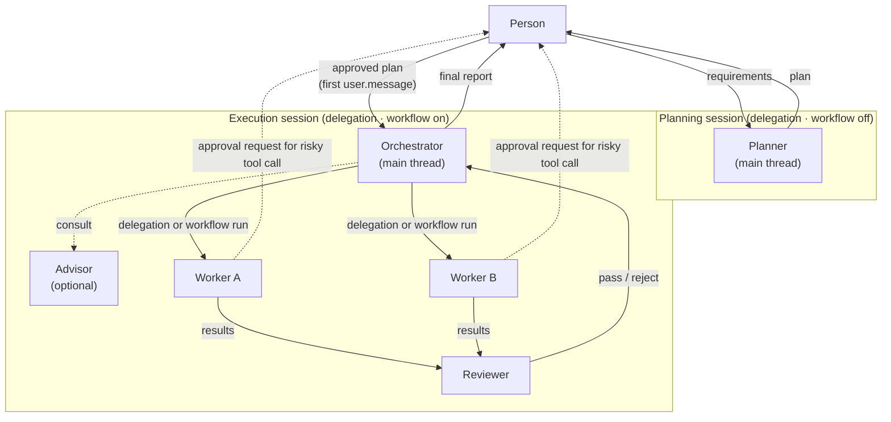

# Human-in-the-Loop multi-agent orchestration: background · purpose · guide

> [!NOTE]
> This document is written for the Managed Agents API. Since the runtime was set to local Claude Code (2026-10-23), the build follows `my-agent-architecture.md`. Use this document for its concepts only.

- Written: 2026-10-23
- Status: draft (v0.1)
- References: the `docs/` folder (list in "References" at the bottom)

## 0. Read first

### 0.1 What this document covers

- The concepts (role structure, points where the person steps in, failure handling) are written to apply regardless of the runtime.
- The build steps follow the features of Claude Managed Agents (beta, `anthropic-beta: managed-agents-2026-04-01`), because the official documents saved in `docs/` are this platform's documents.
- The concepts also apply when building on local Claude Code (subagents, `/workflows`). The API fields and limits differ, though.

### 0.2 Source tags

Each claim in the document is tagged with where it comes from.

| Tag | Meaning | How far to trust it |
|---|---|---|
| **[official]** | Managed Agents documents on platform.claude.com (`docs/` originals) | Can be used as the spec |
| **[Gemini]** | `docs/gemini-*.md` research reports | A reference view. Numbers and other frameworks' APIs are not verified |
| **[proposed]** | A design newly proposed in this document | Needs a decision |

> [!WARNING]
> Some content in the Gemini reports does not match the official documents. The mismatches are collected in section 1.4; this document follows the official documents.

---

## 1. Background

### 1.1 Why multiple agents

**Start with a single agent.** [Gemini]
One agent with good tools, prompts and search is enough for most tasks. More agents also mean more points of failure, more prompts to manage, and more state.

There are three cases where splitting into agents is worth it.

| Reason | Description | Source |
|---|---|---|
| Context protection | Work whose unrelated exploration results would pollute the main context is handled separately, and only a summary comes back | [Gemini] |
| Parallel processing | Independent subtasks (researching several sources, analyzing several files) run at the same time and the results are merged | [official] [Gemini] |
| Specialization | Handed to an agent with a domain-specific system prompt and tools, such as security review or documentation | [official] [Gemini] |
| Asking a stronger model | Only some hard judgments go to a stronger model (advisor) | [official] |

**Cost:** the Gemini report says multi-agent setups use 3~10 times the tokens, but the source of that number is not confirmed. The official documents say "every agent in a run uses tokens, so use runs only for work that needs them." [official]

### 1.2 Why the person needs to step in (HITL)

The more an agent does on its own, the bigger the damage when it makes a mistake on an irreversible decision (deploy, delete, external send, payment). So the person's judgment is inserted.

Stepping in too often and stepping in too late are both problems. [Gemini]

| Problem | Symptom |
|---|---|
| **Stepping in too often** | When approval requests pour in, the person approves without reading (approval fatigue). The point of automation is lost. |
| **Stepping in too late** | The build finishes in the wrong direction, wasting tokens and time. |

**Principle:** the person steps in only "when a stage that can be undone cheaply ends" and "right before an irreversible action." The repeated work of building and fixing is left to the agents. [Gemini]

### 1.3 Features the platform provides [official]

| Feature | What it does | Relation to the person stepping in |
|---|---|---|
| **Subagents** | The main agent hands off work directly and reads the reports. The subagent's thread persists, so follow-up instructions can be sent. | Between the main agent's judgments, it can report to the person and take instructions. |
| **Dynamic workflows** | The main agent writes a program (workflow) and the server runs it in the background (run). Several agents run at the same time per phase. | **There is no approval step before start.** No user input is taken while it runs. |
| **Advisor** | The main thread asks a stronger model for advice during work. | Assists judgment in place of the person. When Opus 5.5 is the advisor, the client sees the advice only as `redacted`, so **the person cannot check its content.** |
| **Session threads** | Each agent has its own event record. Summaries and approval requests gather in the main stream. | One screen, the main stream, is enough for the person. |
| **Permission policy** | Each tool call is approved or not by an `always_ask` or `auto` policy. | The only approval mechanism the platform **enforces**. |
| **Session budget** | Puts a dollar cap on the whole session's spend. On reaching the cap, it stops and goes idle. | A forced stop on the cost side. |
| **Scheduled deployments** | Starts sessions automatically on a cron schedule. | Runs nobody watches, so a way to step in asynchronously is needed. |

### 1.4 Where the Gemini design and the official platform differ

| Claim in the Gemini report | Fact in the official documents | How this document handles it |
|---|---|---|
| 4-level hierarchy: Orchestrator → Architect/Reviewer → Workers → Tools | Delegation goes **one level only**. An agent with `multiagent` set cannot be placed under another agent, and a run cannot start another run. | Make the hierarchy **flat**. The main thread is in charge; the rest are sub-agents at the same level (section 3.2). |
| Put the design approval gate (Gate 1) before the workflow | There is no approval step before a run starts, and the permission policy does not apply to starting a run. "Show the plan and wait" is only a prompt instruction and is not enforced. | Enforce it by **splitting the session in two** (section 3.4). |
| Final acceptance gate: report done once verification passes | A run result of `completed` does not mean the work succeeded. A run can end `completed` even when subtasks failed. | Keep a separate rule for judging completion (section 3.6). |
| Stop with an abort command | `user.interrupt` stops only the current turn and **does not end the run.** | To stop a run, ask the agent by message (section 3.8). |
| Approval APIs of MAF, ADK, KaibanJS and the Dreams spec | Not in the saved official documents. | Use as concepts only, not as a spec. |

---

## 2. Purpose

### 2.1 Goals

1. **Align direction early.** The person approves the plan before the build starts, and an unapproved plan does not run.
2. **Block irreversible actions.** Delete, external send, deploy and package install run only with the person's permission.
3. **Run the middle automatically.** The person is not in the loop of building, getting reviewed and fixing.
4. **Report completion honestly.** At the end, the person gets "what was done, what failed, and what was not covered" in a form they can check.
5. **Set a cost cap.** Stop before the budget is exceeded, and continue after the person decides.

### 2.2 Non-goals

- No system where the person approves every step (because of approval fatigue).
- No service-style infrastructure for many users (3-tier separation, microVM clusters). [Gemini] Too much for personal use.
- Long-term memory consolidation (Dreams, etc.) is out of scope.

### 2.3 Success criteria [proposed]

| Criterion | How to measure |
|---|---|
| Times an execution stage started without approval = 0 | No record of an execution session created without an approved plan |
| Person interventions ≤ 3~4 per task | Only Gate 1, Gate 3, and the exceptional Gate 2 and escalations occur |
| Cases reported "done" despite failures or gaps = 0 | The final report always includes failures and unhandled items |
| Budget overrun = within one request | By official behavior, each thread can go over by up to the one request it had in progress [official] |

---

## 3. Guide

### 3.1 Design principles

1. **Split roles logically, but delegate one level only.** A platform constraint. [official]
2. **Tell apart mechanisms that can enforce from mechanisms that can only ask.** Important gates are enforced with platform features; prompt instructions are only a supplement. [proposed]
3. **Separate the author from the reviewer.** The agent that wrote the code does not review its own code. The reviewer sees only the requirements, the diff and the test results. [Gemini]
4. **A tool called twice must still be safe.** The server reruns a failed agent in a new thread, so the same thing can happen twice. [official]
5. **Pass only decisions to the person.** The screen the person sees is gathered into the main stream; detailed records are opened per thread only when needed. [official] [proposed]

### 3.2 Role structure (flat structure)



| Role | Runs as | Information it sees | Deliverable it produces |
|---|---|---|---|
| **Planner** | main thread of the planning session | requirements, repository structure | plan: scope, task breakdown, acceptance criteria, risks |
| **Orchestrator** | main thread of the execution session | the approved plan, each agent's report | task assignment, starting runs, final report |
| **Worker** | predefined agent (registered in the `subagents` or `workflows` list) | only its task spec and the relevant files | changed code or documents, tests |
| **Reviewer** | predefined agent (a system prompt different from the author's) | requirements, diff, test results | pass/reject and the reasons |
| **Advisor** | `multiagent.advisor` | the whole main thread conversation | advice (may be hidden from the person) |

- **Register Worker and Reviewer as predefined.** [official] [proposed]
  - An inline agent inherits the main agent's MCP servers and tools as is, so its permissions cannot be narrowed.
  - Roles whose permissions must be limited are made in advance and put in the list, and `inline_agents` is turned off with `{"type": "disabled"}`.
- **Choose the delegation method by task size.** [official]
  - **subagents:** when there are few tasks and the next action depends on the results
  - **workflows:** when there are many tasks of the same shape to handle at once

### 3.3 HITL gates at a glance

| Gate | When | Enforced? | How it is built | What the person sees | The person's choices |
|---|---|---|---|---|---|
| **G1 Plan approval** | before the build starts | **enforced** | session split: the execution session is created only after approval (section 3.4) | the plan | Approve / Request changes / Abort |
| **G2 Execution safety** | right before a risky tool call | **enforced** | permission policy `always_ask` (section 3.5) | tool name, arguments, which thread asked | Allow / Deny |
| **G3 Final acceptance** | when all runs have ended and the turn is wrapped up | the judging rule is enforced; the report content depends on the prompt | completion rule + report format (section 3.6) | change summary, test results, list of failures and unhandled items | Accept / Order rework |
| **E Escalation** | when the same rejection repeats N times, the budget is hit, or a run ends with an error | the budget is enforced; the repeat limit depends on the prompt | sections 3.7, 3.8 | where it got stuck and what was tried | Give direction / Adjust budget / Abort |

**No gates inside the build loop.** Approving every single file change causes approval fatigue. [Gemini]

### 3.4 G1: enforcing plan approval by splitting the session

**Why split the session?** [official]

- The platform has no approval step before a run starts.
- An instruction like "show the plan and wait for approval" is not enforced.
- A session copies the agent's settings when it is created, so a session started with an agent that has delegation and workflows turned off has no power to execute, to the end.

**Order** [proposed]

1. **Create the planning session.** Use a Planner agent with both `subagents` and `workflows` turned off. Giving it only read-only tools is safer.
2. **Get the plan.** The format is fixed: scope, task list, acceptance criteria for each task, risks, expected run size (number of phases, number of agents).
3. **The person reviews it.**
   - Change requests go to the same planning session as a `user.message`.
   - On approval, the plan is fixed as the approved version. Leaving an approval line in a local `plan.md` works the same way as the `my-dev` skill.
4. **Create the execution session.** Create it with the Orchestrator agent and **send the full approved plan as the first `user.message`.**
5. **Forbid work outside the plan.** Put "do not do work that is not in the plan; escalate instead" in the Orchestrator's system prompt. This part depends on the prompt.

**Settings example** (agent for the planning session)

```json
{
  "name": "planner",
  "multiagent": {
    "type": "multiagent_20261001",
    "subagents": { "type": "disabled" },
    "workflows": { "type": "disabled" }
  }
}
```

- Leaving out the `multiagent` block entirely makes an agent with no delegation at all.
- To use only the advisor, turn both off as above and turn on only `advisor`. [official]

**Settings example** (agent for the execution session, allowing only listed agents)

```json
{
  "name": "orchestrator",
  "multiagent": {
    "type": "multiagent_20261001",
    "subagents": {
      "type": "enabled",
      "inline_agents": { "type": "disabled" },
      "predefined_agents": ["<worker_id>", "<reviewer_id>"]
    },
    "workflows": {
      "type": "enabled",
      "inline_agents": { "type": "disabled" },
      "predefined_agents": ["<worker_id>", "<reviewer_id>"]
    }
  }
}
```

- With `inline_agents` off, `predefined_agents` must have at least 1 entry. Empty is a 400 error. [official]
- An agent in the list must not have `multiagent` set, because delegation goes one level only. [official]

**Alternative:** a custom tool such as `request_plan_approval` can stop the session in the `requires_action` state. But the agent can skip calling this tool, so it is weaker than splitting the session. [proposed]

### 3.5 G2: execution safety gate

**Divide the tools by whether they need approval.** [Gemini] [proposed]

| Runs without approval | Needs approval (`always_ask`) |
|---|---|
| file reads, edits inside the workspace, unit tests, lint, git status/diff | file deletion, package install, external API calls and sends, `git push`, deploy, secret access |

**Behavior rules** [official]

- **Where requests arrive:** approval requests from sub-threads **are moved to the main stream.** `session_thread_id` tells which thread asked.
- **How to answer:** answer with `user.tool_confirmation` (with `tool_use_id`), and the server forwards it to that thread.
- **When to answer:** do not wait for the whole session to go `idle`; answer **as soon as the event arrives.** While other threads work, the session stays `running`.
- **Avoiding errors:** in the main stream, the idle event can arrive before that tool call event. Sending a confirmation before the call event arrives can give a 400 error, so answer when the call event with `evaluated_permission` of `ask` arrives.
- **With the `auto` policy:**
  - Only the person's `user.message` counts as "user intent". Messages the main agent sends to sub-agents do not count as intent.
  - Calls the server denies do not reach the main stream.
- **No allow-everything code:** code that allows every approval request unconditionally turns `always_ask` into "always allow" in practice.

### 3.6 G3: final acceptance gate

**Completion rule** [official]

To judge the work finished, **both** of the following must hold.

1. Every run created so far has received `workflow_run.status_ended`.
2. After that, `session.status_idle` arrived with `stop_reason: end_turn`, and it was not caused by an abort request I sent.

**Watch out for** [official]

- **What the result means:** `result: completed` only means "the program ran to the end", not that the work succeeded.
- **What idle means:** `idle` alone does not mean finished. When a run stops on the budget, the session goes `idle` but the run is still open.
- **New runs:** the agent can start a new run after reading the results, so check again.

**Final report format** (content for the Orchestrator system prompt) [proposed]

```text
The final report includes all of the following.
1. Work completed against the plan
2. Failed work and the causes
3. Items not covered (including the targets of failed agents)
4. Summary of Reviewer verdicts (including the number of rejections)
5. Change summary (diff stats, test results)
If there is any failure or gap, do not write "done"; write "partially done".
```

**Instructions to put in the workflow** [proposed, based on an official example]

- One failed agent does not fail the whole run; record the failed target as "not handled".
- Have a second-pass agent review every first-pass result, without leaving any out, to find what the first pass missed.

### 3.7 Failure handling and escalation

| Situation | Platform behavior [official] | Design [proposed] |
|---|---|---|
| One agent fails | The server runs it once more in a new thread. If it fails again, the program handles it or ends the run. | The program handles it and adds it to the "not handled" list. |
| Rejections between Worker and Reviewer repeat | No platform limit. | **At most 3 times** [Gemini]. Beyond that, stop that task and report it as an escalation item. |
| Run lifetime exceeded | After the default 24 hours it ends with `timeout_error`. Time passes even while it is stopped. | Write the run lifetime in the plan and set it by prompt. |
| `program_error` or `unknown_error` | The cause is not named. | Read the events of each run thread to find the cause and report it to the person. |
| More than 10 open runs in the same session | `max_workflow_runs_error` occurs. | Fix the number of runs in the plan in advance. |
| Approval requests pile up unhandled | In the `requires_action` state, `user.message` gives a 400 error. | Build the client to handle approval requests first. |

### 3.8 Cost cap and abort [official]

**Budget**

- **When to set it:** it can be set **only when the session is created.** It cannot be added later. The amount is a string in cents (`"2000"` = $20).
- **How it is computed:** at list price. On top of model tokens, web search costs $10 per 1,000 searches and session runtime $0.08 per hour.
- **When the cap is hit:**
  - The session goes `idle` with reason `budget_reached`.
  - It accepts only events that wrap up work in progress (`user.tool_confirmation`, `user.tool_result`, `user.custom_tool_result`, `user.interrupt`).
  - `user.message` is a 400 error.
- **To continue:** raise or remove the cap. Runs stopped by the budget start again.
  - The new cap must be greater than the amount spent so far. Set it at least 1 cent above the reported `usage.list_cost`.
- **Removing the budget:** once removed, it **cannot be set again.** To keep control, change the cap instead of removing it.
- **Multi-agent sessions:** all threads share one budget. Advisor consultations are included.

**Abort**

- **Scope of an abort request:** `user.interrupt` stops only the current turn. **The run does not end.**
- **Ending a run:** to end a run, ask with a `user.message` to "stop the run". A stopped run ends with result `stopped`.
- **Time of a stopped run:** a stopped run's lifetime keeps running, so it can end with `timeout_error`.
- **A run stopped by abort:** raising the budget does not restart it. It needs a message to "continue the run".

**Recommended settings** [proposed]

- Always set a budget on the execution session. Set it to the plan's expected size plus a margin.
- When the budget is hit, notify the person, and raise the cap after the person decides.

### 3.9 Watching progress [official]

- **Screen layout:**
  - **Main stream** (`/v1/sessions/{id}/events/stream`): the screen for the person, where thread creation and status changes, run events, and approval requests gather.
  - **Thread stream** (`/threads/{thread_id}/stream`): open it to see what a given agent is thinking and which tools it called.
- **Run progress:** tracked by the `phases` in `workflow_run.created` and the `phase_started/ended` events.
  - It does not say which thread belongs to which phase.
- **On reconnect:** the stream does not resend missed events.
  - Open the stream first, then query past events with a `types` filter to restore the state.
  - Skip stream events with the same `id` as events already queried.
- **What cannot be seen:** the workflow code itself and the results each thread returned to the workflow are not visible.
  - When the run has ended and the session is `idle`, you can ask the agent to print the workflow it used as is.
  - Keep it for the audit record. [proposed]

### 3.10 Runs nobody watches (scheduled deployments) [official]

- **Budget:** a budget set on a deployment applies **to each run separately.** It is not a cumulative cap.
- **Failure handling:** if a registered sub-agent is archived, the next run is recorded as failed and the deployment pauses automatically.
- **Notification hookup:** run events do not send webhooks. Thread webhooks are sent like those of ordinary sub-threads.
  - Approval request notifications must be hooked to thread events and session events, not run events.
  - The exact list of webhook events needs checking in the `webhooks` document (not saved yet).
- **Relation to G1:** in automatic runs the person cannot approve the plan. [proposed]
  - Run only already-approved recurring work as deployments.
  - G2 approval requests go to the person as notifications and are handled asynchronously.

### 3.11 Official limits

| Item | Value |
|---|---|
| Delegation depth | 1 level (sub-agents cannot have `multiagent` set; a run cannot start a run) |
| `predefined_agents` list | 20 unique agents per list |
| Sub-threads per session | 25 at once (waiting threads count until archived; run threads and advisor threads excluded) |
| Runs open at once in one session | 10 by default (stopped runs count) |
| Threads working at once in one run | 64 (not guaranteed) |
| Agents one run can start | 1,000 in total |
| Run lifetime | 24 hours by default |
| Advisor calls | main thread only |
| Scheduled deployments per organization | 1,000 |

### 3.12 Build plan by stage [proposed]

**Stage 1: start with one agent + G2**
- [ ] Handle 3~5 real tasks with one agent
- [ ] Apply `always_ask` to risky tools and build a client that handles approvals
- [ ] Set a budget and check `budget_reached` handling

**Stage 2: split planning/execution sessions (G1)**
- [ ] Build the Planner agent (delegation and workflow off) + fix the plan format
- [ ] Build the flow that creates the execution session with the approved plan as the first message

**Stage 3: bring in subagents (Worker / Reviewer)**
- [ ] Make Worker and Reviewer predefined agents (only the tools and MCP they need)
- [ ] Turn off `inline_agents`
- [ ] Put the rule "at most 3 rejections → escalation" in the system prompt
- [ ] Apply the final report format (G3)

**Stage 4: bring in workflows for repeated bulk work**
- [ ] Write in the system prompt when to use runs and when not to
- [ ] Add the failure handling instruction ("one failure does not fail the whole run; report the list of what was not handled")
- [ ] Implement the completion rule (section 3.6) in the client
- [ ] Check that calling the same tool twice is safe

**Stage 5: unattended runs (optional)**
- [ ] Move approved recurring work to scheduled deployments
- [ ] Set a budget per run
- [ ] Build the approval request notification path

---

## 4. To decide

| Question | Options | Impact |
|---|---|---|
| Runtime | Managed Agents API / local Claude Code (extending `my-dev`) / a mix of both | The build methods and limits in sections 3.4~3.11 change |
| Target work | software development / research · docs / other work | The kinds of Worker and the G2 approval list change |
| Approval notification channel | terminal / Slack / web page | How asynchronous intervention (section 3.10) is built |
| Rejection repeat limit N | 2 / 3 / set per task | Balance of cost and quality |
| Use the advisor or not | use / do not use | With Opus 5.5, the advice is hidden from the person, which makes auditing hard |

---

## References

| File | Source | What it covers |
|---|---|---|
| `docs/ref/multiagent-orchestration.md` | [official](https://platform.claude.com/docs/en/managed-agents/multiagent-orchestration) | subagents, workflows, advisor settings |
| `docs/ref/workflow-runs.md` | [official](https://platform.claude.com/docs/en/managed-agents/workflow-runs) | run states and events, completion rule, abort, limits |
| `docs/ref/session-threads.md` | [official](https://platform.claude.com/docs/en/managed-agents/session-threads) | thread management, how approval requests reach the main stream |
| `docs/ref/budgets.md` | [official](https://platform.claude.com/docs/en/managed-agents/budgets) | session budgets |
| `docs/ref/scheduled-deployments.md` | [official](https://platform.claude.com/docs/en/managed-agents/scheduled-deployments) | cron-based unattended runs |
| `docs/ref/gemini-multi-agent-architecture-guide.md` | Gemini research | 4-level role model, 3 HITL points |
| `docs/ref/gemini-human-in-the-loop.md` | Gemini research | criteria for adopting it, patterns, HITL framework examples |

Official documents not yet saved: `permission-policies`, `events-and-streaming`, `webhooks`, `define-outcomes`. Saving them before finalizing sections 3.5 and 3.10 is recommended.
