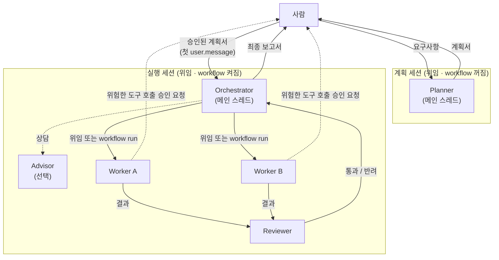

# Human-in-the-Loop 멀티 에이전트 오케스트레이션: 배경 · 목적 · 가이드

> [!NOTE]
> 이 문서는 Managed Agents API를 기준으로 쓴 문서입니다. 실행 환경을 로컬 Claude Code로 정했으므로(2026-10-23), 구현은 `my-agent-architecture.md`를 따릅니다. 이 문서는 개념만 참고합니다.

- 작성일: 2026-10-23
- 상태: 초안 (v0.1)
- 참고 자료: `docs/` 폴더 (목록은 맨 아래 "참고 자료")

## 0. 먼저 읽을 것

### 0.1 이 문서가 다루는 범위

- 개념(역할 구조, 사람이 개입하는 지점, 실패 처리)은 실행 환경과 상관없이 쓸 수 있게 적었습니다.
- 구현 방법은 Claude Managed Agents(베타, `anthropic-beta: managed-agents-2026-04-01`)의 기능에 맞춰 적었습니다. `docs/`에 저장한 공식 문서가 이 플랫폼 문서이기 때문입니다.
- 로컬 Claude Code(서브에이전트, `/workflows`)로 구현할 때도 개념은 그대로 쓸 수 있습니다. 다만 API 필드와 제한값은 다릅니다.

### 0.2 출처 표시

문서 안의 주장마다 어디서 온 내용인지 표시했습니다.

| 표시 | 뜻 | 믿어도 되는 정도 |
|---|---|---|
| **[공식]** | platform.claude.com의 Managed Agents 문서 (`docs/` 원문) | 사양으로 써도 됨 |
| **[Gemini]** | `docs/gemini-*.md` 조사 보고서 | 참고 관점. 수치나 다른 프레임워크 API는 검증 안 됨 |
| **[제안]** | 이 문서에서 새로 제안하는 설계 | 결정이 필요함 |

> [!WARNING]
> Gemini 보고서의 일부 내용은 공식 문서와 맞지 않습니다. 맞지 않는 부분은 1.4절에 모았고, 이 문서는 공식 문서를 기준으로 합니다.

---

## 1. 배경

### 1.1 왜 멀티 에이전트인가

**단일 에이전트부터 시작합니다.** [Gemini]
도구, 프롬프트, 검색을 잘 갖춘 에이전트 하나로 대부분의 작업은 충분합니다. 에이전트를 여럿 두면 실패할 수 있는 지점, 관리할 프롬프트, 상태가 함께 늘어납니다.

에이전트를 나눌 만한 경우는 다음 세 가지입니다.

| 이유 | 설명 | 출처 |
|---|---|---|
| 컨텍스트 보호 | 관련 없는 탐색 결과가 메인 컨텍스트를 오염시키는 작업은 따로 떼어 처리하고 요약만 돌려받음 | [Gemini] |
| 병렬 처리 | 서로 독립된 하위 작업(여러 출처 조사, 여러 파일 분석)을 동시에 실행한 뒤 결과를 합침 | [공식] [Gemini] |
| 전문화 | 보안 검토, 문서화처럼 분야별 시스템 프롬프트와 도구를 가진 에이전트에 맡김 | [공식] [Gemini] |
| 상위 모델에 묻기 | 어려운 일부 판단만 더 강한 모델(advisor)에게 물어봄 | [공식] |

**비용:** Gemini 보고서는 멀티 에이전트가 토큰을 3~10배 쓴다고 하지만 출처가 확인되지 않은 수치입니다. 공식 문서는 "run 안의 모든 에이전트가 토큰을 쓰니 꼭 필요한 작업에만 run을 쓰라"고 합니다. [공식]

### 1.2 왜 사람이 개입해야 하는가 (HITL)

에이전트가 스스로 하는 일이 많아질수록 되돌릴 수 없는 결정(배포, 삭제, 외부 전송, 결제)에서 실수했을 때 손해가 커집니다. 그래서 사람의 판단을 끼워 넣습니다.

개입이 너무 잦거나 너무 늦으면 둘 다 문제입니다. [Gemini]

| 문제 | 증상 |
|---|---|
| **너무 자주 개입** | 승인 요청이 쏟아지면 사람이 내용을 읽지 않고 승인합니다(승인 피로). 자동화한 의미가 사라집니다. |
| **너무 늦게 개입** | 방향이 틀린 채로 구현이 끝나 토큰과 시간을 버립니다. |

**원칙:** 사람은 "적은 비용으로 되돌릴 수 있는 단계가 끝날 때"와 "되돌릴 수 없는 실행을 하기 직전"에만 개입합니다. 구현하고 고치는 반복 작업은 에이전트끼리 처리하게 둡니다. [Gemini]

### 1.3 플랫폼이 제공하는 기능 [공식]

| 기능 | 하는 일 | 사람 개입과의 관계 |
|---|---|---|
| **Subagents** | 메인 에이전트가 직접 일을 맡기고 보고를 읽습니다. 서브에이전트의 스레드가 계속 유지되어 후속 지시를 보낼 수 있습니다. | 메인 에이전트가 판단하는 사이사이에 사람에게 보고하고 지시를 받을 수 있습니다. |
| **Dynamic workflows** | 메인 에이전트가 프로그램(workflow)을 짜면 서버가 백그라운드에서 실행합니다(run). 단계(phase)별로 여러 에이전트를 동시에 돌립니다. | **시작 전 승인 단계가 없습니다.** 실행 중에는 사용자 입력을 받지 않습니다. |
| **Advisor** | 메인 스레드가 작업 중에 더 강한 모델에게 조언을 구합니다. | 사람 대신 판단을 보조합니다. Opus 5.5가 조언자면 클라이언트에는 조언 내용이 `redacted`로만 보여서 **사람이 내용을 확인할 수 없습니다.** |
| **Session threads** | 에이전트마다 따로 이벤트 기록을 갖습니다. 메인 스트림에는 요약과 승인 요청이 모입니다. | 사람이 보는 화면은 메인 스트림 하나로 충분합니다. |
| **Permission policy** | 도구를 호출할 때마다 `always_ask` 또는 `auto` 정책으로 승인 여부를 정합니다. | 플랫폼이 **강제하는** 유일한 승인 장치입니다. |
| **Session budget** | 세션 전체 지출에 달러 상한을 겁니다. 상한에 닿으면 멈추고 대기(idle) 상태가 됩니다. | 비용 측면에서 강제로 멈추는 장치입니다. |
| **Scheduled deployments** | cron 일정에 맞춰 세션을 자동으로 시작합니다. | 사람이 지켜보지 않는 실행이므로 비동기로 개입할 방법이 필요합니다. |

### 1.4 Gemini 설계와 공식 플랫폼이 다른 부분

| Gemini 보고서의 주장 | 공식 문서의 사실 | 이 문서의 처리 |
|---|---|---|
| 4단계 계층: Orchestrator → Architect/Reviewer → Workers → Tools | 위임은 **한 단계만** 됩니다. `multiagent`가 설정된 에이전트는 다른 에이전트의 하위로 넣을 수 없고, run 안에서 다시 run을 시작할 수도 없습니다. | 계층을 **평평하게** 만듭니다. 메인 스레드가 총괄을 맡고, 나머지는 같은 높이의 하위 에이전트로 둡니다 (3.2절). |
| 설계 승인 게이트(Gate 1)를 workflow 앞에 둠 | run을 시작하기 전 승인 단계가 없고, permission policy도 run 시작에는 적용되지 않습니다. "계획을 보여주고 기다려라"는 프롬프트 지시일 뿐 강제되지 않습니다. | **세션을 둘로 나눠서** 강제합니다 (3.4절). |
| 최종 수용 게이트: 검증을 통과하면 완료 보고 | run 결과가 `completed`여도 작업이 성공했다는 뜻은 아닙니다. 하위 작업이 실패해도 `completed`로 끝날 수 있습니다. | 완료를 판정하는 규칙을 따로 둡니다 (3.6절). |
| 중단 명령으로 멈춤 | `user.interrupt`는 현재 턴만 멈추고 **run은 끝내지 않습니다.** | run을 멈추려면 에이전트에게 메시지로 요청합니다 (3.8절). |
| MAF, ADK, KaibanJS의 승인 API와 Dreams 사양 | 저장한 공식 문서에는 없는 내용입니다. | 개념만 참고하고 사양으로 쓰지 않습니다. |

---

## 2. 목적

### 2.1 목표

1. **방향을 일찍 맞춥니다.** 구현을 시작하기 전에 사람이 계획을 승인하고, 승인되지 않은 계획은 실행되지 않게 합니다.
2. **되돌릴 수 없는 행동을 막습니다.** 삭제, 외부 전송, 배포, 패키지 설치는 사람이 허락해야만 실행됩니다.
3. **중간 과정은 자동으로 돌립니다.** 구현하고, 검토받고, 고치는 반복에는 사람이 끼지 않습니다.
4. **완료를 정직하게 보고합니다.** 끝나면 "무엇을 했고, 무엇이 실패했고, 무엇을 다루지 못했는지"를 사람이 확인할 수 있는 형태로 받습니다.
5. **비용 상한을 둡니다.** 예산을 넘기 전에 멈추고, 사람이 판단한 뒤 이어서 진행합니다.

### 2.2 목표가 아닌 것

- 모든 단계를 사람이 승인하는 시스템은 만들지 않습니다(승인 피로 때문).
- 여러 사용자가 접속하는 서비스형 인프라(3계층 분리, microVM 클러스터)는 다루지 않습니다. [Gemini] 개인용으로는 과합니다.
- 장기 메모리 정리(Dreams 등)는 범위 밖입니다.

### 2.3 성공 기준 [제안]

| 기준 | 측정 방법 |
|---|---|
| 승인 없이 실행 단계가 시작된 횟수 = 0 | 실행 세션이 승인된 계획 없이 만들어진 기록이 없음 |
| 사람 개입 횟수 ≤ 작업 1건당 3~4회 | Gate 1, Gate 3, 그리고 예외적인 Gate 2와 에스컬레이션만 발생 |
| 실패나 누락이 있는데 "완료"로 보고된 경우 = 0 | 최종 보고서에 실패와 미처리 항목이 반드시 들어감 |
| 예산 초과 = 요청 1회분 이내 | 공식 동작상 스레드마다 진행 중이던 요청 1회분까지는 넘을 수 있음 [공식] |

---

## 3. 가이드

### 3.1 설계 원칙

1. **역할은 논리적으로 나누되, 위임은 한 단계만** 둡니다. 플랫폼 제약입니다. [공식]
2. **강제할 수 있는 장치와 부탁만 할 수 있는 장치를 구분합니다.** 중요한 게이트는 플랫폼 기능으로 강제하고, 프롬프트 지시는 보조로만 씁니다. [제안]
3. **작성자와 검토자를 분리합니다.** 코드를 쓴 에이전트는 자기 코드를 검토하지 않습니다. 검토자는 요구사항, diff, 테스트 결과만 봅니다. [Gemini]
4. **같은 도구가 두 번 호출되어도 안전해야 합니다.** 서버는 실패한 에이전트를 새 스레드에서 다시 실행하므로 같은 일이 두 번 일어날 수 있습니다. [공식]
5. **사람에게는 결정만 넘깁니다.** 사람에게 보이는 화면은 메인 스트림 하나로 모으고, 세부 기록은 필요할 때만 스레드별로 열어 봅니다. [공식] [제안]

### 3.2 역할 구조 (평평한 구조)



| 역할 | 실행 형태 | 보는 정보 | 내놓는 결과물 |
|---|---|---|---|
| **Planner** | 계획 세션의 메인 스레드 | 요구사항, 저장소 구조 | 계획서: 범위, 작업 분할, 수용 기준, 위험 요소 |
| **Orchestrator** | 실행 세션의 메인 스레드 | 승인된 계획서, 각 에이전트의 보고 | 작업 배분, run 시작, 최종 보고서 |
| **Worker** | predefined 에이전트 (`subagents` 또는 `workflows` 목록에 등록) | 맡은 작업 명세와 해당 파일만 | 수정한 코드나 문서, 테스트 |
| **Reviewer** | predefined 에이전트 (작성자와 다른 시스템 프롬프트) | 요구사항, diff, 테스트 결과 | 통과/반려와 그 근거 |
| **Advisor** | `multiagent.advisor` | 메인 스레드 대화 전체 | 조언 (사람에게는 가려질 수 있음) |

- **Worker와 Reviewer는 predefined로 등록합니다.** [공식] [제안]
  - inline 에이전트는 메인 에이전트의 MCP 서버와 도구를 그대로 물려받아 권한을 줄일 수 없습니다.
  - 권한을 제한해야 하는 역할은 미리 만들어 목록에 넣고, `inline_agents`를 `{"type": "disabled"}`로 끕니다.
- **위임 방식은 작업 크기에 따라 고릅니다.** [공식]
  - **subagents:** 작업이 적고 결과를 보면서 다음 행동을 정할 때
  - **workflows:** 같은 형태의 작업이 많아 한꺼번에 처리할 때

### 3.3 HITL 게이트 한눈에 보기

| 게이트 | 시점 | 강제 여부 | 구현 방법 | 사람이 보는 것 | 사람의 선택지 |
|---|---|---|---|---|---|
| **G1 계획 승인** | 구현 시작 전 | **강제** | 세션 분리: 실행 세션은 승인 후에만 생성 (3.4절) | 계획서 | 승인 / 수정 요청 / 중단 |
| **G2 실행 안전** | 위험한 도구를 호출하기 직전 | **강제** | permission policy `always_ask` (3.5절) | 도구 이름, 인자, 어느 스레드의 요청인지 | 허용 / 거부 |
| **G3 최종 수용** | 모든 run이 끝나고 턴이 마무리됐을 때 | 판정 규칙은 강제, 보고 내용은 프롬프트 의존 | 완료 판정 규칙 + 보고서 형식 (3.6절) | 변경 요약, 테스트 결과, 실패·미처리 목록 | 수용 / 재작업 지시 |
| **E 에스컬레이션** | 같은 반려가 N번 반복되거나, 예산에 닿거나, run이 오류로 끝났을 때 | 예산은 강제, 반복 한도는 프롬프트 의존 | 3.7절, 3.8절 | 막힌 지점과 시도한 내용 | 방향 제시 / 예산 조정 / 중단 |

**구현 루프 안에는 게이트를 두지 않습니다.** 파일을 하나 고칠 때마다 승인을 받으면 승인 피로가 생깁니다. [Gemini]

### 3.4 G1: 세션을 나눠 계획 승인을 강제하기

**왜 세션을 나누나요?** [공식]

- run을 시작하기 전에 승인받는 단계는 플랫폼에 없습니다.
- "계획을 보여주고 승인을 기다려라"라는 지시는 강제되지 않습니다.
- 세션은 만들어질 때 에이전트 설정을 복사하기 때문에, 위임과 workflow를 끈 에이전트로 시작한 세션은 끝까지 실행 능력이 없습니다.

**진행 순서** [제안]

1. **계획 세션을 만듭니다.** `subagents`와 `workflows`를 모두 끈 Planner 에이전트를 씁니다. 읽기 전용 도구만 주면 더 안전합니다.
2. **계획서를 받습니다.** 형식은 고정합니다: 범위, 작업 목록, 각 작업의 수용 기준, 위험 요소, 예상 run 규모(단계 수, 에이전트 수).
3. **사람이 검토합니다.**
   - 수정 요청은 같은 계획 세션에 `user.message`로 보냅니다.
   - 승인하면 계획서를 승인본으로 확정합니다. 로컬 `plan.md`에 승인 줄을 남기는 방식은 `my-dev` 스킬과 같습니다.
4. **실행 세션을 만듭니다.** Orchestrator 에이전트로 만들고, **승인된 계획서 전문을 첫 `user.message`로 보냅니다.**
5. **계획 밖의 일을 금지합니다.** Orchestrator의 시스템 프롬프트에 "계획서에 없는 작업은 하지 말고 에스컬레이션하라"를 넣습니다. 이 부분은 프롬프트에 의존합니다.

**설정 예시** (계획 세션용 에이전트)

```json
{
  "name": "planner",
  "multiagent": {
    "type": "multiagent_20261001",
    "subagents": { "type": "disabled" },
    "workflows": { "type": "disabled" }
  }
}
```

- `multiagent` 블록을 아예 빼면 위임 기능 자체가 없는 에이전트가 됩니다.
- advisor만 쓰고 싶다면 위처럼 둘을 끄고 `advisor`만 켭니다. [공식]

**설정 예시** (실행 세션용 에이전트, 목록에 등록한 에이전트만 허용)

```json
{
  "name": "orchestrator",
  "multiagent": {
    "type": "multiagent_20261001",
    "subagents": {
      "type": "enabled",
      "inline_agents": { "type": "disabled" },
      "predefined_agents": ["<worker_id>", "<reviewer_id>"]
    },
    "workflows": {
      "type": "enabled",
      "inline_agents": { "type": "disabled" },
      "predefined_agents": ["<worker_id>", "<reviewer_id>"]
    }
  }
}
```

- `inline_agents`를 끄면 `predefined_agents`에 최소 1개는 있어야 합니다. 비어 있으면 400 오류입니다. [공식]
- 목록에 넣는 에이전트에는 `multiagent`가 설정돼 있으면 안 됩니다. 위임이 한 단계만 되기 때문입니다. [공식]

**대안:** `request_plan_approval` 같은 커스텀 도구를 만들어 세션을 `requires_action` 상태로 멈추는 방법도 있습니다. 하지만 에이전트가 이 도구를 호출하지 않고 건너뛸 수 있어서 세션 분리보다 약합니다. [제안]

### 3.5 G2: 실행 안전 게이트

**어떤 도구를 승인받을지 나눕니다.** [Gemini] [제안]

| 승인 없이 실행 | 승인 필요 (`always_ask`) |
|---|---|
| 파일 읽기, 작업 공간 안의 수정, 단위 테스트, lint, git status/diff | 파일 삭제, 패키지 설치, 외부 API 호출과 전송, `git push`, 배포, 비밀값 접근 |

**동작 규칙** [공식]

- **요청이 오는 곳:** 하위 스레드의 승인 요청은 **메인 스트림으로 옮겨져 옵니다.** `session_thread_id`로 어느 스레드의 요청인지 알 수 있습니다.
- **응답 방법:** `user.tool_confirmation`(`tool_use_id` 포함)으로 답하면 서버가 해당 스레드로 전달합니다.
- **응답 시점:** 세션 전체가 `idle`이 될 때까지 기다리지 말고, **이벤트가 도착하는 즉시** 답합니다. 다른 스레드가 일하는 동안 세션은 계속 `running`으로 남아 있습니다.
- **오류 피하기:** 메인 스트림에서 idle 이벤트가 해당 도구 호출 이벤트보다 먼저 올 수 있습니다. 호출 이벤트가 오기 전에 확인을 보내면 400 오류가 날 수 있으니, `evaluated_permission`이 `ask`인 호출 이벤트가 도착하면 그때 답합니다.
- **`auto` 정책일 때:**
  - 사람의 `user.message`만 "사용자 의도"로 인정됩니다. 메인 에이전트가 하위 에이전트에게 보낸 메시지는 의도로 치지 않습니다.
  - 서버가 거부한 호출은 메인 스트림으로 오지 않습니다.
- **모두 허용하는 코드 금지:** 승인 요청을 무조건 허용하는 코드를 넣으면 `always_ask`가 사실상 "항상 허용"이 됩니다.

### 3.6 G3: 최종 수용 게이트

**완료 판정 규칙** [공식]

작업이 끝났다고 판단하려면 아래 두 가지가 **모두** 맞아야 합니다.

1. 지금까지 생긴 모든 run이 `workflow_run.status_ended`를 받았습니다.
2. 그 뒤에 `session.status_idle`이 `stop_reason: end_turn`으로 왔고, 내가 보낸 중단 요청 때문에 생긴 것이 아닙니다.

**주의할 점** [공식]

- **결과의 의미:** `result: completed`는 "프로그램이 끝까지 실행됐다"는 뜻일 뿐, 작업이 성공했다는 뜻이 아닙니다.
- **대기 상태의 의미:** `idle` 하나만으로는 끝났다고 보면 안 됩니다. run이 예산 때문에 멈추면 세션은 `idle`이 되지만 run은 아직 열려 있습니다.
- **새 run:** 에이전트가 결과를 읽은 뒤 run을 새로 시작할 수 있으므로 다시 확인합니다.

**최종 보고서 형식** (Orchestrator 시스템 프롬프트에 넣을 내용) [제안]

```text
최종 보고서는 다음 항목을 모두 포함한다.
1. 계획서 대비 완료한 작업
2. 실패한 작업과 원인
3. 다루지 못한 항목 (실패한 에이전트가 맡았던 대상 포함)
4. Reviewer 판정 요약 (반려 횟수 포함)
5. 변경 요약 (diff 통계, 테스트 결과)
하나라도 실패나 누락이 있으면 "완료"라고 쓰지 말고 "부분 완료"라고 쓴다.
```

**workflow에 넣을 지시** [공식 예시를 바탕으로 한 제안]

- 에이전트 하나가 실패해도 run 전체가 실패하지 않게 하고, 실패한 대상은 "처리 못 함"으로 기록합니다.
- 1차 결과를 하나도 빼놓지 않고 2차 에이전트가 다시 검토하게 해서, 1차에서 놓친 것을 찾습니다.

### 3.7 실패 처리와 에스컬레이션

| 상황 | 플랫폼 동작 [공식] | 설계 [제안] |
|---|---|---|
| 에이전트 하나가 실패 | 서버가 새 스레드에서 한 번 더 실행합니다. 또 실패하면 프로그램이 처리하거나 run을 끝냅니다. | 프로그램이 처리하고 "처리 못 함" 목록에 올립니다. |
| Worker와 Reviewer 사이의 반려가 반복됨 | 플랫폼 제한은 없습니다. | **최대 3회** [Gemini]. 넘으면 해당 작업을 멈추고 에스컬레이션 항목으로 보고합니다. |
| run 수명 초과 | 기본 24시간이 지나면 `timeout_error`로 끝납니다. 멈춰 있는 동안에도 시간이 흐릅니다. | 계획서에 run 수명을 적고, 프롬프트로 지정합니다. |
| `program_error` 또는 `unknown_error` | 원인이 이름으로 나오지 않습니다. | 각 run 스레드의 이벤트를 읽어 원인을 찾고 사람에게 보고합니다. |
| 같은 세션에 열린 run이 10개를 넘음 | `max_workflow_runs_error`가 납니다. | 계획서에서 run 수를 미리 정해 둡니다. |
| 승인 요청이 처리되지 않고 쌓임 | `requires_action` 상태에서는 `user.message`가 400 오류를 냅니다. | 승인 요청부터 처리하는 순서로 클라이언트를 만듭니다. |

### 3.8 비용 상한과 중단 [공식]

**예산(budget)**

- **설정 시점:** 세션을 **만들 때만** 걸 수 있습니다. 나중에 추가할 수 없습니다. 금액은 센트 단위 문자열입니다(`"2000"` = $20).
- **계산 방식:** 정가 기준으로 계산합니다. 모델 토큰에 더해 웹 검색 1,000회당 $10, 세션 실행 시간 1시간당 $0.08이 들어갑니다.
- **상한에 닿으면:**
  - 세션이 `idle` 상태가 되고 이유는 `budget_reached`입니다.
  - 진행 중인 작업을 마무리하는 이벤트(`user.tool_confirmation`, `user.tool_result`, `user.custom_tool_result`, `user.interrupt`)만 받습니다.
  - `user.message`는 400 오류입니다.
- **다시 진행하려면:** 상한을 올리거나 없앱니다. 예산 때문에 멈췄던 run이 다시 돌아갑니다.
  - 새 상한은 지금까지 쓴 금액보다 커야 합니다. 보고된 `usage.list_cost`보다 1센트 이상 높게 잡습니다.
- **예산 제거:** 한 번 없애면 **다시 걸 수 없습니다.** 계속 통제하려면 없애지 말고 상한을 바꾸세요.
- **멀티 에이전트 세션:** 모든 스레드가 예산 하나를 나눠 씁니다. advisor 상담 비용도 포함됩니다.

**중단**

- **중단 요청의 범위:** `user.interrupt`는 현재 턴만 멈춥니다. **run은 끝나지 않습니다.**
- **run 끝내기:** run을 끝내려면 `user.message`로 "run을 멈춰라"라고 요청합니다. 멈춘 run은 결과가 `stopped`로 끝납니다.
- **멈춘 run의 시간:** 멈춘 run도 수명은 계속 흘러가서 `timeout_error`로 끝날 수 있습니다.
- **중단으로 멈춘 run:** 예산을 올려도 다시 돌아가지 않습니다. "run을 이어서 하라"는 메시지가 필요합니다.

**권장 설정** [제안]

- 실행 세션에는 항상 예산을 겁니다. 계획서의 예상 규모에 여유분을 더해 정합니다.
- 예산에 닿으면 사람에게 알리고, 사람이 판단한 뒤 상한을 올립니다.

### 3.9 진행 상황 관찰 [공식]

- **화면 구성:**
  - **메인 스트림**(`/v1/sessions/{id}/events/stream`): 스레드 생성·상태 변경, run 이벤트, 승인 요청이 모이는 사람용 화면입니다.
  - **스레드 스트림**(`/threads/{thread_id}/stream`): 특정 에이전트가 무엇을 생각하고 어떤 도구를 불렀는지 볼 때 엽니다.
- **run 진행률:** `workflow_run.created`에 들어 있는 `phases`와 `phase_started/ended` 이벤트로 추적합니다.
  - 어느 스레드가 어느 단계에 속하는지는 알려주지 않습니다.
- **다시 연결했을 때:** 스트림은 놓친 이벤트를 다시 보내지 않습니다.
  - 먼저 스트림을 연 다음, 지난 이벤트를 `types` 필터로 조회해 상태를 복원합니다.
  - 이미 조회한 이벤트와 같은 `id`의 스트림 이벤트는 건너뜁니다.
- **볼 수 없는 것:** workflow 코드 자체와 각 스레드가 workflow에 돌려준 결과는 보이지 않습니다.
  - run이 끝나고 세션이 `idle`일 때, 에이전트에게 사용한 workflow를 그대로 출력해 달라고 요청할 수 있습니다.
  - 감사 기록용으로 보관해 둡니다. [제안]

### 3.10 사람이 지켜보지 않는 실행 (scheduled deployments) [공식]

- **예산:** 배포(deployment)에 건 예산은 **실행 1회마다 따로** 적용됩니다. 누적 상한이 아닙니다.
- **실패 처리:** 등록한 하위 에이전트가 보관(archive)되면 다음 실행이 실패로 기록되고, 배포가 자동으로 일시정지됩니다.
- **알림 연결:** run 이벤트는 웹훅을 보내지 않습니다. 스레드 웹훅은 일반 하위 스레드처럼 보냅니다.
  - 승인 요청 알림은 run 이벤트가 아니라 스레드 이벤트와 세션 이벤트에 연결해야 합니다.
  - 정확한 웹훅 이벤트 목록은 `webhooks` 문서에서 확인이 필요합니다(아직 저장 안 함).
- **G1과의 관계:** 자동 실행에서는 사람이 계획을 승인할 수 없습니다. [제안]
  - 이미 승인된 반복 작업만 배포로 돌립니다.
  - G2 승인 요청은 알림으로 사람에게 보내 비동기로 처리합니다.

### 3.11 공식 제한값

| 항목 | 값 |
|---|---|
| 위임 깊이 | 1단계 (하위 에이전트는 `multiagent` 설정 불가, run 안에서 run 시작 불가) |
| `predefined_agents` 목록 | 목록마다 고유 에이전트 20개 |
| 세션의 하위 스레드 | 동시에 25개 (보관 전까지는 대기 중인 스레드도 셈. run 스레드와 advisor 스레드는 제외) |
| 한 세션에서 동시에 열린 run | 기본 10개 (멈춰 있는 run도 셈) |
| 한 run에서 동시에 일하는 스레드 | 64개 (보장되는 값은 아님) |
| 한 run이 시작할 수 있는 에이전트 | 총 1,000개 |
| run 수명 | 기본 24시간 |
| advisor 호출 | 메인 스레드만 가능 |
| 조직당 scheduled deployment | 1,000개 |

### 3.12 단계별 구축 계획 [제안]

**1단계: 에이전트 하나로 시작 + G2**
- [ ] 에이전트 하나로 실제 작업 3~5건 처리하기
- [ ] 위험한 도구에 `always_ask` 적용하고 승인 처리 클라이언트 만들기
- [ ] 예산 걸고 `budget_reached` 처리 확인하기

**2단계: 계획/실행 세션 분리 (G1)**
- [ ] Planner 에이전트 만들기 (위임·workflow 꺼짐) + 계획서 형식 확정
- [ ] 승인된 계획서를 첫 메시지로 넣어 실행 세션 만드는 흐름 구현

**3단계: subagents 도입 (Worker / Reviewer)**
- [ ] Worker와 Reviewer를 predefined 에이전트로 만들기 (도구와 MCP는 꼭 필요한 것만)
- [ ] `inline_agents` 끄기
- [ ] 반려 최대 3회 → 에스컬레이션 규칙을 시스템 프롬프트에 넣기
- [ ] 최종 보고서 형식 적용 (G3)

**4단계: 반복적인 대량 작업에 workflows 도입**
- [ ] 시스템 프롬프트에 run을 쓸 때와 쓰지 않을 때 적기
- [ ] 실패 처리 지시("하나가 실패해도 run 전체는 실패시키지 않음, 처리 못 한 목록 보고") 넣기
- [ ] 완료 판정 규칙(3.6절)을 클라이언트에 구현
- [ ] 같은 도구를 두 번 호출해도 안전한지 점검

**5단계: 무인 실행 (선택)**
- [ ] 승인된 반복 작업을 scheduled deployment로 옮기기
- [ ] 실행 1회당 예산 걸기
- [ ] 승인 요청 알림 경로 구축

---

## 4. 정해야 할 것

| 질문 | 선택지 | 영향 |
|---|---|---|
| 실행 환경 | Managed Agents API / 로컬 Claude Code (`my-dev` 확장) / 두 가지 혼합 | 3.4~3.11절의 구현 방법과 제한값이 달라짐 |
| 대상 업무 | 소프트웨어 개발 / 조사·문서 / 그 밖의 업무 | Worker 종류와 G2 승인 목록이 달라짐 |
| 승인 알림 채널 | 터미널 / Slack / 웹 화면 | 비동기 개입(3.10절)의 구현 방법 |
| 반려 반복 한도 N | 2 / 3 / 작업마다 지정 | 비용과 품질의 균형 |
| advisor 사용 여부 | 사용 / 사용 안 함 | Opus 5.5를 쓰면 조언 내용이 사람에게 가려져 감사가 어려움 |

---

## 참고 자료

| 파일 | 출처 | 다루는 내용 |
|---|---|---|
| `docs/ref/multiagent-orchestration.md` | [공식](https://platform.claude.com/docs/en/managed-agents/multiagent-orchestration) | subagents, workflows, advisor 설정 |
| `docs/ref/workflow-runs.md` | [공식](https://platform.claude.com/docs/en/managed-agents/workflow-runs) | run 상태와 이벤트, 완료 판정, 중단, 제한값 |
| `docs/ref/session-threads.md` | [공식](https://platform.claude.com/docs/en/managed-agents/session-threads) | 스레드 관리, 승인 요청이 메인 스트림으로 오는 방식 |
| `docs/ref/budgets.md` | [공식](https://platform.claude.com/docs/en/managed-agents/budgets) | 세션 예산 |
| `docs/ref/scheduled-deployments.md` | [공식](https://platform.claude.com/docs/en/managed-agents/scheduled-deployments) | cron 기반 무인 실행 |
| `docs/ref/gemini-multi-agent-architecture-guide.md` | Gemini 조사 | 4단계 역할 모델, HITL 3지점 |
| `docs/ref/gemini-human-in-the-loop.md` | Gemini 조사 | 도입 판단 기준, 패턴, HITL 프레임워크 사례 |

아직 확보하지 않은 공식 문서: `permission-policies`, `events-and-streaming`, `webhooks`, `define-outcomes`. 3.5절과 3.10절을 확정하기 전에 저장해 두는 것을 권장합니다.
