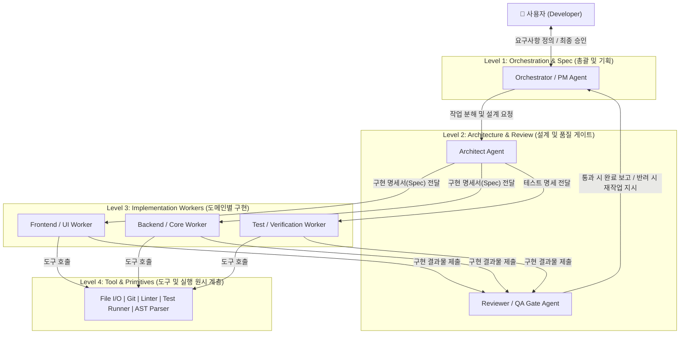
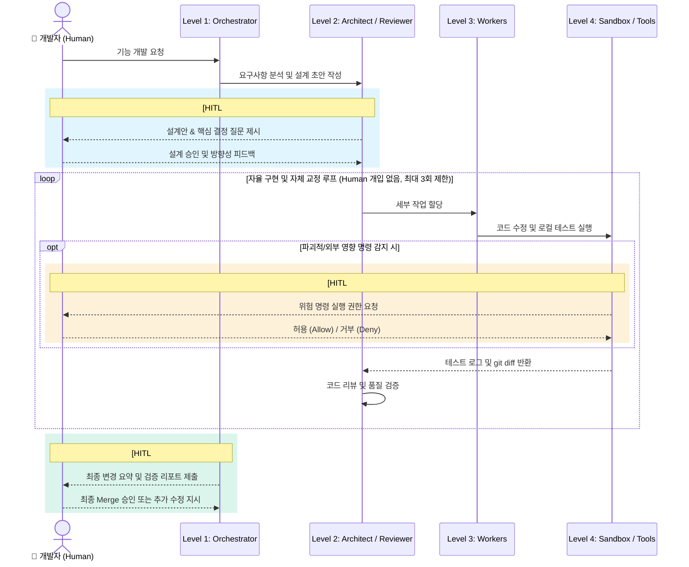

# 소프트웨어 개발 멀티 에이전트 아키텍처 가이드
**Level(논리적 계층), Tier(물리적 격리), 그리고 Human-in-the-Loop(HITL) 설계 전략**

소프트웨어 개발을 자동화하는 멀티 에이전트 스킬(Skill)을 구축할 때 가장 중요한 설계 원칙은 **"에이전트 간의 역할 분담은 논리적 Level(Layer)로 해결하고, 코드 실행의 안전성은 물리적 Tier로 제어하며, 사람의 개입(HITL)은 비가역적 결정 지점에만 배치한다"**는 것입니다.

---

## 1. Level (논리적 계층) 구조: 4-Level 역할 모델

인간의 작업 기억 한계(Cowan의 $4 \pm 1$ 법칙)와 소프트웨어 공학의 관심사 분리 원칙에 따라, 에이전트의 의사결정 권한과 컨텍스트 범위를 **4단계(Level 1 ~ Level 4)**로 구분하는 것을 권장합니다.

### 계층별 핵심 책임과 컨텍스트 격리 규칙

| 계층 | 담당 에이전트 | 입력 컨텍스트 (보는 정보) | 출력 아티팩트 | 핵심 원칙 |
| :--- | :--- | :--- | :--- | :--- |
| **Level 1** | **Orchestrator (PM)** | 사용자 프롬프트, 전체 프로젝트 요약 구조 | 요구사항 정의서(PRD), 작업 분할 구조(DAG) | 직접 코드를 짜지 않으며, 전체 진행 상태만 관리 |
| **Level 2** | **Architect / Reviewer** | Level 1의 계획서, 변경된 코드의 `git diff`, 테스트 결과 | 인터페이스 명세서, 리뷰 통과/반려 판정 | 구현 에이전트와 분리된 시각에서 품질 게이트 역할 수행 |
| **Level 3** | **Worker (Coder / Tester)** | 담당할 특정 파일들과 Level 2가 내린 단일 작업 명세 | 실제 소스코드 수정본, 단위 테스트 코드 | 전체 프로젝트를 보지 않고 **할당된 좁은 파일 범위**에만 집중 |
| **Level 4** | **Tools & Primitives** | 정형화된 함수 인자 (경로, 명령어 등) | 실행 표준 출력(stdout/stderr), 종료 코드 | LLM 추론이 없는 결정론적(Deterministic) 도구 계층 |

> [!TIP]
> **왜 Level 2(Reviewer)와 Level 3(Worker)를 분리하나요?**
> 코드를 작성한 에이전트에게 스스로 검증하라고 하면 확증 편향(Confirmation Bias)으로 인해 자신의 버그를 합리화합니다. **작성자의 전체 추론 과정을 모르는 Reviewer 에이전트**가 오직 `요구사항 명세 + git diff + 테스트 통과 여부`만 보고 평가해야 환각과 결함을 정확히 잡아냅니다.

---

## 2. Tier (물리적 티어) 구조: 개인용 vs 팀/서비스용

Level 1~3의 에이전트들은 서로 다른 서버에 띄울 필요가 없습니다. 모두 **하나의 오케스트레이션 런타임 안에서 프롬프트와 컨텍스트만 달리하여 호출**하면 됩니다. 물리적 Tier 분리는 오직 **"에이전트가 생성한 코드를 어디서 실행할 것인가(보안 및 격리)"**에 의해 결정됩니다.

### A. 개인용 멀티 에이전트 스킬 (권장: 1.5-Tier / 로컬 샌드박스형)

개인 개발 환경에서는 인프라 복잡도를 최소화하되, 호스트 OS 보호만 챙기는 구성이 가장 효율적입니다.

* **Tier 1 (Host Runtime Tier - 로컬 머신)**:
  * IDE(Antigravity, VS Code) 및 에이전트 오케스트레이터 실행
  * 파일 읽기/쓰기 및 Git 브랜치 관리
* **Tier 1.5 (Lightweight Sandbox - 프로세스/컨테이너 격리)**:
  * 기본 파일 편집과 린트/단위 테스트는 내장 **Terminal Sandbox**에서 즉시 실행
  * 외부 패키지 대량 설치, DB 마이그레이션, 파괴적 스크립트 실행이 필요할 때만 **로컬 Docker 컨테이너**를 일시적으로 띄워 실행

### B. 엔터프라이즈/서비스형 시스템 (3-Tier 완전 격리형)

다수의 사용자가 웹/앱으로 접속해 코딩 에이전트를 쓰는 경우에만 아래의 3-Tier 분리가 필요합니다.

1. **Tier 1 (Client Tier)**: 사용자의 IDE 플러그인 또는 웹 UI
2. **Tier 2 (Orchestration Tier)**: 에이전트 상태 머신, LLM API 라우터, API Key 보관 서버
3. **Tier 3 (Execution Sandbox Tier)**: Firecracker microVM, E2B, 격리된 컨테이너 클러스터 (코드 빌드·실행 전용)

> [!IMPORTANT]
> 개인용 스킬을 만든다면 **Tier를 나누는 데 시간을 쓰지 마세요.** 대신 작업 시작 전 `git checkout -b agent/task-name`으로 전용 브랜치를 파거나 `git worktree`를 활용하는 것이 물리적 서버 분리보다 훨씬 실용적인 안전망이 됩니다.

---

## 3. Human-in-the-Loop (HITL)의 최적 위치

사람이 너무 자주 개입하면 멀티 에이전트를 쓰는 의미(자동화 효율)가 사라지고, 너무 늦게 개입하면 잘못된 방향으로 수천 줄의 코드가 작성되어 토큰과 시간을 날립니다.

HITL은 **"비용이 싸고 되돌리기 쉬운 단계의 끝"**과 **"파괴적/비가역적 실행의 직전"** 딱 3곳에만 배치해야 합니다.

### HITL 3대 배치 지점 상세

#### ① HITL Gate 1: 설계 정렬 게이트 (Level 1 $\leftrightarrow$ Level 2 사이) — **가장 중요**
* **타이밍**: 요구사항을 분석하고 아키텍처/작업 계획을 세운 직후, **실제 코드 작성(Level 3)에 들어가기 직전**.
* **역할**: 에이전트가 임의로 넘겨짚은 가정(Assumptions)을 교정합니다. (`/grill-me` 스타일의 인터뷰나 구현 계획서 승인 단계)
* **이유**: 설계 단계에서 방향을 10도 수정하는 비용은 프롬프트 몇 줄이지만, 구현 완료 후 수정하는 비용은 전체 재작성입니다.

#### ② HITL Gate 2: 런타임 안전 게이트 (Level 4 실행 경계) — **예외적 개입**
* **타이밍**: Level 3 Worker가 Level 4 도구를 호출할 때, **비가역적이거나 외부 환경에 영향을 주는 작업**이 감지된 순간.
* **개입 대상**:
  * **자동 통과 (No HITL)**: 파일 읽기, 워크스페이스 내 코드 수정, 단위 테스트 실행, 린트 체크, 로컬 Git 상태 확인.
  * **승인 필요 (HITL 작동)**: 새로운 외부 라이브러리 설치(`npm install`), 파일/디렉터리 영구 삭제, 외부 네트워크 API 호출, `git push`, 환경 변수/시크릿 접근.

#### ③ HITL Gate 3: 에스컬레이션 & 최종 수용 게이트 (Level 2 $\rightarrow$ Level 1 종료 시점)
* **타이밍**:
  1. **정상 종료 시**: Level 2 Reviewer의 검증까지 모두 통과한 후, 사람이 최종 `git diff`와 테스트 리포트를 보고 메인 브랜치에 병합(Merge)할지 결정할 때.
  2. **데드락(Deadlock) 발생 시**: `Level 3 구현` $\leftrightarrow$ `Level 2 리뷰 반려` 루프가 **3회 이상 반복**되어도 테스트를 통과하지 못할 때, 토큰 낭비를 멈추고 사람에게 판단을 요청(Escalation)합니다.

> [!WARNING]
> **피해야 할 안티패턴: Level 3(구현 루프) 내부에 HITL 넣기**
> Worker 에이전트가 파일 하나를 고칠 때마다 사람에게 "이 코드가 맞나요?"라고 묻게 설계하면, 개발자는 피로감(Approval Fatigue) 때문에 내용을 읽지 않고 무조건 승인 버튼을 누르게 됩니다. **구현과 1차 디버깅(Level 3 $\leftrightarrow$ Level 2)은 에이전트끼리 자율적으로 루프를 돌게 두어야 합니다.**

---

## 4. 개인용 멀티 에이전트 스킬 구축을 위한 실전 요약표

| 설계 항목 | 추천 구성 | 핵심 구현 팁 |
| :--- | :--- | :--- |
| **에이전트 구성 (Level)** | **4-Level** (Orchestrator - Reviewer - Worker - Tools) | 에이전트 간 대화는 메모리 내 메시지나 마크다운 아티팩트 파일(`plan.md`, `review.md`)로 전달 |
| **인프라 격리 (Tier)** | **1-Tier (로컬)** + **Git Worktree / 브랜치 격리** | 별도 서버 구축 없이, 서브에이전트마다 독립된 Git 브랜치(또는 Worktree)를 부여해 충돌 방지 |
| **사람의 개입 (HITL)** | **앞단(설계 확정)**과 **뒷단(최종 Diff 승인)**에 집중 | 중간 구현 과정은 최대 $N$회(예: 3회)까지 에이전트 자율 수정 루프 허용 후 실패 시에만 호출 |
